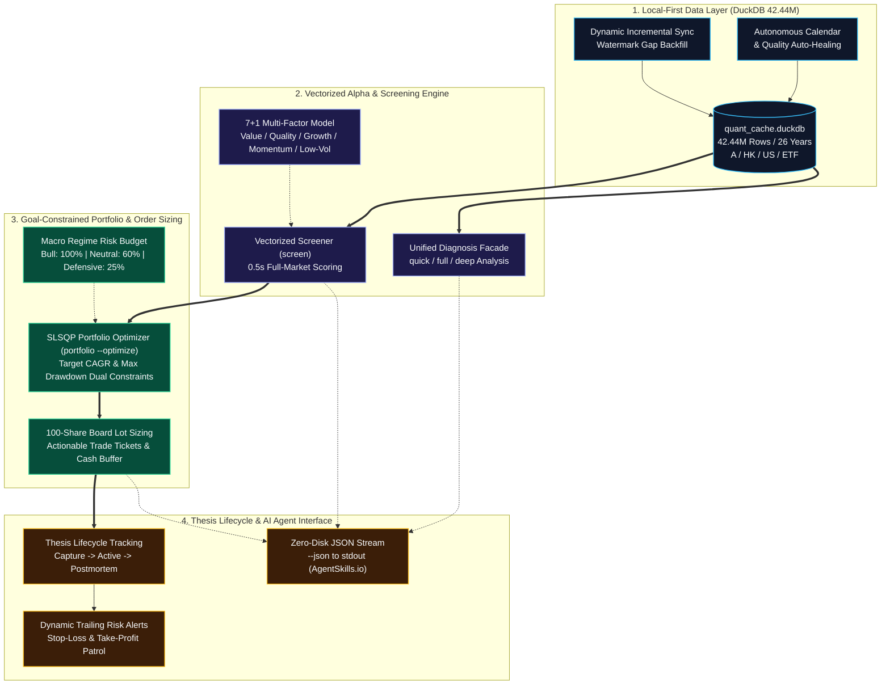

# stockaskill

[English](README.md) | [简体中文](README_ZH.md) | [Documentation Portal](docs/README.md) | [Hands-On Tutorial](docs/en/tutorial.md)

---

**stockaskill** is an **offline-first, full-data-driven quantitative investment decision and analysis engine** designed for medium-to-long-term quantitative screening, portfolio optimization, risk budgeting, and trade execution timing.

Powered by the high-performance columnar engine **DuckDB** (holding **42.44 million rows** of daily OHLCV and fundamental records spanning 26 years across China A-shares, Hong Kong, US equities, and ETFs), stockaskill delivers sub-second vectorized screening, goal-constrained portfolio optimization, dynamic incremental synchronization, A-share 100-share board lot ticket sizing, and thesis lifecycle management.

> [!NOTE]
> - **Storage Architecture**: DuckDB (`quant_cache.duckdb`) is the sole active storage and analytical engine; the legacy SQLite database (`quant_cache.db`) is preserved strictly as an untouched, read-only offline cold archive.
> - **Fund Scope**: The `FUND` data path implements **ETF-first semantics** and is not intended for broad mutual fund coverage.

---

## Core Quantitative Capabilities



1. **Strictly Local-First**: Remote APIs are exclusively synchronization mechanisms, never query layers. All screening, factor scoring, and portfolio optimization run 100% locally in DuckDB with **0 network latency**.
2. **Dynamic Incremental Synchronization (`sync update`)**: Never downloads full market history blindly; inspects local watermarks and retrieves missing date windows (with a 3-day safety overlap) to prevent API rate-limit exhaustion.
3. **Sub-Second Vectorized Multi-Factor Screening (`screen`)**: Powered by DuckDB OLAP window functions and columnar SIMD execution, evaluating all 5,400+ A-share stocks takes only **0.2 to 0.5 seconds**.
4. **Goal-Constrained Modern Portfolio Optimization (`portfolio --optimize`)**: Utilizes the SLSQP convex optimizer to solve optimal Sharpe allocations under rigid constraints on Target CAGR and Maximum Drawdown, automatically sizing positions into valid A-share 100-share board lots.
5. **Unified Multi-Level Single-Stock Diagnosis (`diagnose`)**: Unified facade supporting `quick` (sub-second core factor snapshot), `full` (7-factor radar and financial health), and `deep` (long-form report with valuation percentiles and peer analysis).
6. **Thesis Lifecycle Management & Dynamic Risk Monitoring (`thesis` / `risk-alert`)**: Complete closed-loop tracking: `Entry Rationale -> Daily Position Health -> Trailing Stop Alerts -> Postmortem Attribution`.
7. **AI Agent First-Class Citizen**: All CLI commands support `--json` streaming directly to `stdout` with zero disk overhead, fully compliant with the [AgentSkills.io Specification](https://agentskills.io/home).

---

## Documentation Center

Comprehensive bilingual documentation is available under `docs/`:

| Language | Document Link | Description |
|:---|:---|:---|
| 🇬🇧 English | [Hands-On Practical Tutorial](docs/en/tutorial.md) | Step-by-step quant workflow guide from setup to board lot execution |
| 🇬🇧 English | [System Overview & Architecture](docs/en/README.md) | Complete system architecture, quant models, and optimization solver |
| 🇬🇧 English | [CLI Reference & Agent Tools](docs/en/cli-reference.md) | Exhaustive CLI flags, `--json` streaming protocols, and options |
| 🇬🇧 English | [DuckDB Local-First Data Strategy](docs/en/data-strategy.md) | Columnar schemas, sync state watermarks, and multi-source fallbacks |
| 🇨🇳 中文 | [实战操作教程](docs/zh/tutorial.md) | 从环境安装、增量保鲜、截面选股到整手组合优化的保姆级实战步骤 |
| 🇨🇳 中文 | [功能全景手册与架构设计](docs/zh/README.md) | 系统定位、底层设计、7+1 多因子体系与业务闭环 |
| 🇨🇳 中文 | [CLI 命令行完整字典](docs/zh/cli-reference.md) | 20+ 个核心命令的完整参数、标志位与 Agent 工具调用示例 |
| 🇨🇳 中文 | [DuckDB 本地优先数据策略](docs/zh/data-strategy.md) | 4,244 万行数据物理表结构、水位线同步、多源熔断降级规范 |

---

## Supported Agent Frameworks

Compatible with all major AI Agent and code assistant frameworks using standard `SKILL.md`:

| Framework | Skill Path | Loading Mechanism | Invocation |
|-----------|------------|-------------------|------------|
| [opencode](https://opencode.ai) | `.opencode/skills/stockaskill/` or `~/.config/opencode/skills/stockaskill/` | On-demand (skill tool) | Intent match / `skill stockaskill` |
| [claudecode](https://docs.anthropic.com/en/docs/claude-code/overview) | `.claude/skills/stockaskill/` or `~/.claude/skills/stockaskill/` | On-demand (description match) | Auto-trigger / `/stockaskill` |
| [codex](https://developers.openai.com/codex) | `.agents/skills/stockaskill/` or `~/.agents/skills/stockaskill/` | On-demand (description match) | Auto-trigger / `$stockaskill` |
| [openclaw](https://docs.openclaw.ai) | `<workspace>/skills/stockaskill/` or `~/.openclaw/skills/stockaskill/` | Session startup | Auto-injected / `/stockaskill` |
| Cursor | `.cursor/rules/stockaskill.mdc` | Rule matching | Context-aware match |
| Windsurf | `.windsurf/rules/` | Session startup | Auto-injected |

---

## Quickstart

### 1. Environment Setup

Requires **Python >= 3.10**. We strongly recommend `uv`:

```bash
# Clone the repository
git clone https://github.com/axjing/stockaskill.git
cd stockaskill

# Create and activate Python 3.10 virtual environment
uv venv --python 3.10
# Windows: .venv\Scripts\activate
# Unix: source .venv/bin/activate

# Install dependencies in editable mode
uv pip install -e .
```

### 2. Verify Engine & Dataset

```bash
# Verify active storage engine (confirm DuckDB)
uv run python skills/stockaskill/scripts/run.py cache engine

# Inspect local dataset statistics (42.44M rows)
uv run python skills/stockaskill/scripts/run.py cache stats
```

---

## Essential CLI Commands

### 1. Sub-Second Vectorized Multi-Factor Screening (`screen`)

Evaluates and ranks all 5,400+ A-share stocks in ~0.5s:

```bash
# Low-volatility defensive strategy (Top 10)
uv run python skills/stockaskill/scripts/run.py screen --market A --preset low_vol --top 10

# Momentum-enhanced trend leader strategy (Top 5)
uv run python skills/stockaskill/scripts/run.py screen --market A --preset momentum_enhanced --top 5

# Deep value turnaround strategy (Low PE/PB + High F-Score)
uv run python skills/stockaskill/scripts/run.py screen --market A --preset deep_value --top 10

# Custom factor weights
uv run python skills/stockaskill/scripts/run.py screen --market A \
  --value-weight 0.2 --quality-weight 0.3 --momentum-weight 0.3 --growth-weight 0.2 --top 8
```

### 2. Goal-Constrained Portfolio Optimization (`portfolio --optimize`)

Solves optimal Sharpe allocations under rigid constraints on Target CAGR and Max Drawdown, outputting valid 100-share board lot tickets:

```bash
# Target CAGR=12%, Max Drawdown=6%, Capital=500k CNY across 5 stocks
uv run python skills/stockaskill/scripts/run.py portfolio \
  --codes 600519,000858,601318,600036,002475 \
  --market A \
  --optimize \
  --target-cagr 0.12 \
  --max-drawdown 0.06 \
  --capital 500000
```

Output includes:
- Macro regime risk budget (Bull 100% / Neutral 60% / Defensive 25%)
- SLSQP theoretical optimal weights
- Actionable 100-share board lot buy tickets with required capital and leftover cash buffer

### 3. Unified Multi-Level Single-Stock Diagnosis (`diagnose`)

```bash
# Quick diagnosis (~0.1s, core factors and concise verdict)
uv run python skills/stockaskill/scripts/run.py diagnose 600519 --market A --level quick

# Full diagnosis (default level, 7-factor radar and financial health)
uv run python skills/stockaskill/scripts/run.py diagnose 600519 --market A --level full

# Deep diagnosis (long-form report with historical valuation percentiles and peer analysis)
uv run python skills/stockaskill/scripts/run.py diagnose 600519 --market A --level deep
```

### 4. Dynamic Incremental Sync & Quality Auditing (`sync` / `status`)

```bash
# Inspect symbol or watchlist data freshness (0 network calls)
uv run python skills/stockaskill/scripts/run.py status data symbol 600519 --market A
uv run python skills/stockaskill/scripts/run.py status data watchlist --market A

# Incrementally update single symbol (fetches only missing bars)
uv run python skills/stockaskill/scripts/run.py sync update 600519 --market A

# Incrementally update entire watchlist scope
uv run python skills/stockaskill/scripts/run.py sync update --scope watchlist --market A

# Data quality audit and circuit-breaker repairs
uv run python skills/stockaskill/scripts/run.py sync check --market A --codes 600519,000858
uv run python skills/stockaskill/scripts/run.py sync repair --market A --codes 600519
```

### 5. Thesis Tracking & Dynamic Risk Alerts (`thesis` / `risk-alert`)

```bash
# Capture entry thesis and rationale
uv run python skills/stockaskill/scripts/run.py thesis capture 600519 --market A \
  --notes "Low volatility blue chip; dividend yield > 3.5%" --catalyst "Steady earnings growth"

# Daily portfolio risk monitoring & trailing stop alerts
uv run python skills/stockaskill/scripts/run.py risk-alert --market A

# Trade exit postmortem and attribution
uv run python skills/stockaskill/scripts/run.py thesis postmortem --code 600519 --market A \
  --outcome win --return-pct 15.2 --notes "Exited at target resistance level"
```

---

## 7+1 Multi-Factor Model

| Factor | Default Weight | Core Metrics & Logic | Empirical Reference |
|:---|:---:|:---|:---|
| **Value** | 20% | Composite PE / PB / Dividend Yield percentiles | Huatai Securities EP+BP Factor |
| **Quality** | 25% | ROE / Gross Margin / Debt Ratio / Free Cash Flow | Changjiang Securities Snowball Factor |
| **Growth** | 17% | YoY Revenue & Net Profit Compound Growth | CSC Financial Surprise Factor |
| **Momentum** | 17% | 6-month momentum (excluding recent 1-month reversal) + MA alignment | China A-Share Momentum Anomaly |
| **Low Volatility** | 11% | 12-month daily return volatility (inverse scoring) | Guotai Junan Low Volatility Anomaly |
| **Size** | 9% | `log(Market Cap)` small-cap premium scoring | China A-Share Small-Cap Premium |
| **Analyst** | Auxiliary | Consensus earnings revisions and rating upgrades | Smart Money & Institutional Consensus |

---

## AI Agent Integration Protocol

For LLM Tool Calling workflows, all subcommands support `--json`:
- **Clean Standard Output**: Emits valid, minified JSON to `stdout` with no visual terminal styling.
- **Zero Disk Overhead**: Agents parse structured JSON directly from the process pipeline.

```bash
# Agent Tool Calling Examples
uv run python skills/stockaskill/scripts/run.py screen --market A --preset low_vol --top 5 --json
uv run python skills/stockaskill/scripts/run.py diagnose 600519 --market A --level quick --json
```

---

## Automated Testing & Engineering Quality

This repository adheres to rigorous engineering standards:
- **Code Consistency**: Follows Google Python Style Guide, enforced by `ruff check` and `ruff format`.
- **Test Suite**: Comprehensive automated test suite comprising **392 test cases** across engines, factors, solvers, and edge cases with 100% pass rate.

```bash
# Run linting and formatting checks
uv run ruff check skills/stockaskill/scripts tests
uv run ruff format --check skills/stockaskill/scripts tests

# Run all 392 automated test cases
uv run python -m pytest tests/
```

---

## Disclaimer

1. All quantitative screening results, factor ratings, and portfolio allocations generated by this system are for academic research and software demonstration only. **They do not constitute investment advice**.
2. Past performance in backtests does not guarantee future returns. Investing involves substantial risk.
