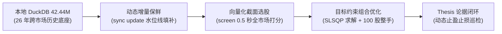

# stockaskill

[English](README.md) | [简体中文](README_ZH.md) | [文档中心 / Docs](docs/README.md) | [实战教程 / Tutorial](docs/zh/tutorial.md)

---

**stockaskill** 是一个**离线全量数据驱动、本地优先的量化投资决策与分析引擎**，专为中长期量化选股、组合优化、风险预算控制与买卖时机决策打造。

底层搭载高性能列式存储引擎 **DuckDB**（内置跨 A 股 / 港股 / 美股 / ETF 26 年历史周期的 **4,244 万行** 高质量日线行情与基本面数据），具备亚秒级全市场截面选股、目标约束组合优化求解、动态增量保鲜、A 股 100 股整手交易单生成与投资论据全生命周期跟踪能力。

> [!NOTE]
> - **存储架构**：DuckDB (`quant_cache.duckdb`) 为当前唯一活跃存储与分析引擎；历史 SQLite 文件 (`quant_cache.db`) 严格保留为只读离线冷备归档。
> - **基金覆盖**：当前 `FUND` 路径按 **ETF-first** 语义提供高精度支持，不等同于广义公募基金全覆盖。

---

## 核心定量能力一览



1. **真正本地优先（Local-First）**：绝不无节制调用远程 API。分析、选股、因子计算、回测 100% 优先在本地 DuckDB 列式引擎执行，实现 **0 网络时延** 与毫秒级反馈。
2. **动态增量同步（Incremental Sync）**：从不盲目全量拉取。通过 `sync update` 自动比对最新水位线，仅拉取缺失日期窗口（含 3 天安全重叠区），避免触发 API 限额。
3. **亚秒级向量化多因子选股（`screen`）**：基于 DuckDB OLAP 窗口函数与列式向量化计算，从 5,400+ 只股票的全历史截面中筛选优质标的仅需 **0.2 ~ 0.5 秒**。
4. **目标约束现代组合优化（`portfolio --optimize`）**：基于 SLSQP 凸优化求解器，在目标年化（Target CAGR）与最大回撤（Max Drawdown）双重刚性约束下求解最佳夏普权重，并自动按 A 股 100 股整手（Board Lot）生成交易票单。
5. **单标的多级诊断门面（`diagnose`）**：统一整合 `quick`（快速因子速查）、`full`（7 大因子雷达与财务健康）、`deep`（估值分位与同业对比长报告）三级诊断。
6. **投资论据追踪与动态风控（`thesis` / `risk-alert`）**：建立 `建仓论据 -> 持仓巡检 -> 动态止损预警 -> 平仓复盘归因` 的完整决策闭环。
7. **智能体原生协同（Agent-First）**：所有 CLI 命令支持 `--json` 输出标准化数据流至标准输出（stdout），零磁盘中间文件，完美兼容 [AgentSkills.io](https://agentskills.io/home) 规范。

---

## 官方文档中心

本项目在 `docs/` 目录提供了详尽的中英文双语工程与实战文档：

| 语言 | 文档链接 | 核心内容 |
|:---|:---|:---|
| 🇨🇳 中文 | [实战操作教程](docs/zh/tutorial.md) | 从环境安装、增量保鲜、截面选股到整手组合优化的保姆级实战步骤 |
| 🇨🇳 中文 | [功能全景手册与架构设计](docs/zh/README.md) | 系统定位、底层设计、7+1 多因子体系与业务闭环 |
| 🇨🇳 中文 | [CLI 命令行完整字典](docs/zh/cli-reference.md) | 20+ 个核心命令的完整参数、标志位与 Agent 工具调用示例 |
| 🇨🇳 中文 | [DuckDB 本地优先数据策略](docs/zh/data-strategy.md) | 4,244 万行数据物理表结构、水位线同步、多源熔断降级规范 |
| 🇬🇧 English | [Hands-On Practical Tutorial](docs/en/tutorial.md) | Step-by-step quant workflow guide from setup to board lot execution |
| 🇬🇧 English | [System Overview & Architecture](docs/en/README.md) | Complete system architecture, quant models, and optimization solver |
| 🇬🇧 English | [CLI Reference & Agent Tools](docs/en/cli-reference.md) | Exhaustive CLI flags, `--json` streaming protocols, and options |
| 🇬🇧 English | [DuckDB Local-First Data Strategy](docs/en/data-strategy.md) | Columnar schemas, sync state watermarks, and multi-source fallbacks |

---

## 适用框架与智能体集成

兼容以下主流智能体与代码助手框架，均使用标准 `SKILL.md` 格式：

| 框架 | 技能路径 | 加载方式 | 调用方式 |
|------|---------|---------|---------|
| [opencode](https://opencode.ai) | `.opencode/skills/stockaskill/` 或 `~/.config/opencode/skills/stockaskill/` | 按需加载 (skill 工具) | 自动匹配意图 / `skill stockaskill` |
| [claudecode](https://docs.anthropic.com/en/docs/claude-code/overview) | `.claude/skills/stockaskill/` 或 `~/.claude/skills/stockaskill/` | 按需加载 (描述匹配) | 自动触发 / `/stockaskill` |
| [codex](https://developers.openai.com/codex) | `.agents/skills/stockaskill/` 或 `~/.agents/skills/stockaskill/` | 按需加载 (描述匹配) | 自动触发 / `$stockaskill` |
| [openclaw](https://docs.openclaw.ai) | `<workspace>/skills/stockaskill/` 或 `~/.openclaw/skills/stockaskill/` | 会话启动加载 | 自动注入 / `/stockaskill` |
| Cursor | `.cursor/rules/stockaskill.mdc` | 规则匹配 | 自动匹配文件上下文 |
| Windsurf | `.windsurf/rules/` | 会话启动加载 | 自动注入 |

---

## 快速上手

### 1. 环境准备

要求 **Python >= 3.10**。推荐使用 `uv`：

```bash
# 克隆代码仓库
git clone https://github.com/axjing/stockaskill.git
cd stockaskill

# 创建并激活 Python 3.10 虚拟环境
uv venv --python 3.10
# Windows: .venv\Scripts\activate
# Unix: source .venv/bin/activate

# 安装依赖
uv pip install -e .
```

### 2. 检查存储引擎与数据底座

```bash
# 确认当前底层引擎为 DuckDB
uv run python skills/stockaskill/scripts/run.py cache engine

# 查看本地数据总量与分布 (42.44M 行数据)
uv run python skills/stockaskill/scripts/run.py cache stats
```

---

## 核心命令精选

### 1. 亚秒级多因子截面选股 (`screen`)

0.5 秒内完成全市场 5,400+ 只股票的截面排序，支持多种成熟策略预设：

```bash
# 低波动稳健防御型选股 (筛选前 10 只)
uv run python skills/stockaskill/scripts/run.py screen --market A --preset low_vol --top 10

# 动量增强型主升浪龙头选股
uv run python skills/stockaskill/scripts/run.py screen --market A --preset momentum_enhanced --top 5

# 深度价值反转选股 (低估值 + 高财务质量)
uv run python skills/stockaskill/scripts/run.py screen --market A --preset deep_value --top 10

# 自定义多因子权重选股
uv run python skills/stockaskill/scripts/run.py screen --market A \
  --value-weight 0.2 --quality-weight 0.3 --momentum-weight 0.3 --growth-weight 0.2 --top 8
```

### 2. 目标约束现代组合优化与整手下单 (`portfolio --optimize`)

在目标年化与最大回撤硬性约束下求解最佳夏普权重，并自动转换为 A 股 100 股整手（Board Lot）交易单：

```bash
# 目标年化 12%，最大回撤 6%，可用资金 50 万元，对 5 只标的进行求解
uv run python skills/stockaskill/scripts/run.py portfolio \
  --codes 600519,000858,601318,600036,002475 \
  --market A \
  --optimize \
  --target-cagr 0.12 \
  --max-drawdown 0.06 \
  --capital 500000
```

输出内容包含：
- 宏观状态风险预算与总权益仓位上限（牛市 100% / 中性 60% / 防御 25%）
- SLSQP 数学最优化理论权重
- 实际可执行的 100 股整手买入单、占用资金与预留闲置现金（Cash buffer）

### 3. 单标的多级深度诊断 (`diagnose`)

```bash
# 快速诊断 (耗时约 0.1s，展示核心因子与简评)
uv run python skills/stockaskill/scripts/run.py diagnose 600519 --market A --level quick

# 完整诊断 (默认级别，包含 7 大因子雷达与财务健康度)
uv run python skills/stockaskill/scripts/run.py diagnose 600519 --market A --level full

# 深度长报告诊断 (包含估值历史分位数、同业对标与风险警示)
uv run python skills/stockaskill/scripts/run.py diagnose 600519 --market A --level deep
```

### 4. 动态增量保鲜与数据质量 (`sync` / `status`)

```bash
# 查看单只股票或自选股数据保鲜状态 (本地 0 网络请求)
uv run python skills/stockaskill/scripts/run.py status data symbol 600519 --market A
uv run python skills/stockaskill/scripts/run.py status data watchlist --market A

# 增量更新单个标的 (仅拉取最新缺失区间)
uv run python skills/stockaskill/scripts/run.py sync update 600519 --market A

# 增量更新整个自选股监控池
uv run python skills/stockaskill/scripts/run.py sync update --scope watchlist --market A

# 数据质量巡检与分层修复
uv run python skills/stockaskill/scripts/run.py sync check --market A --codes 600519,000858
uv run python skills/stockaskill/scripts/run.py sync repair --market A --codes 600519
```

### 5. 投资论据跟踪与动态风控 (`thesis` / `risk-alert`)

```bash
# 记录建仓论据与入场价格
uv run python skills/stockaskill/scripts/run.py thesis capture 600519 --market A \
  --notes "低波动蓝筹配置，股息率 > 3.5%" --catalyst "业绩稳健增长"

# 每日持仓异动与动态止盈止损巡检预警
uv run python skills/stockaskill/scripts/run.py risk-alert --market A

# 平仓出场复盘与盈亏归因
uv run python skills/stockaskill/scripts/run.py thesis postmortem --code 600519 --market A \
  --outcome win --return-pct 15.2 --notes "达到目标盈利位止盈平仓"
```

---

## 7+1 多因子策略体系

| 因子 | 默认权重 | 核心指标与逻辑 | 参考策略 |
|:---|:---:|:---|:---|
| **估值因子** | 20% | PE / PB / 股息率复合估值分位 | 华泰证券 EP+BP 因子 |
| **质量因子** | 25% | ROE / 毛利率 / 资产负债率 / FCF 自由现金流 | 长江证券雪球因子 |
| **成长因子** | 17% | 营收与归母净利润同比复合增速 | 中信建投超预期因子 |
| **动量因子** | 17% | 6 个月动量（剔除近 1 个月短期反转）+ 均线多头排列 | A 股动量增强因子 |
| **低波因子** | 11% | 12 个月日收益率波动率负向打分 | 国泰君安低波动异象因子 |
| **市值因子** | 9% | `log(总市值)` 规模溢价打分 | A 股小市值溢价模型 |
| **分析师因子** | 辅助 | 机构盈利预期修正与评级上调 | 聪明钱与机构共识因子 |

---

## 智能体（AI Agent）调用规范

针对 LLM Tool Calling 场景，所有命令支持 `--json` 输出：
- **纯净数据**：stdout 只输出紧凑、合法的 JSON 字符串，无终端彩色控制字符污染。
- **零磁盘 I/O**：Agent 通过标准输出直接解析结构化对象，无需写入或读取临时文件。

```bash
# 智能体调用范例
uv run python skills/stockaskill/scripts/run.py screen --market A --preset low_vol --top 5 --json
uv run python skills/stockaskill/scripts/run.py diagnose 600519 --market A --level quick --json
```

---

## 自动化测试与工程质量

本项目执行严格的质量把控规范：
- **代码规范**：遵循 Google Python Style Guide，`ruff check` 与 `ruff format` 强制代码一致性。
- **自动化测试**：内置 **392 项** 全量自动化测试用例，覆盖引擎、因子、优化器、数据同步与边缘异常，CI 全绿通过。

```bash
# 运行代码规范检查
uv run ruff check skills/stockaskill/scripts tests
uv run ruff format --check skills/stockaskill/scripts tests

# 运行全量 392 项自动化测试
uv run python -m pytest tests/
```

---

## 免责声明

1. 本项目输出的所有量化分析结果、多因子评分与组合建议仅供学术研究与工程实践参考，**不构成任何投资建议**。
2. 历史回测表现不代表未来实际收益，市场有风险，投资需谨慎。
