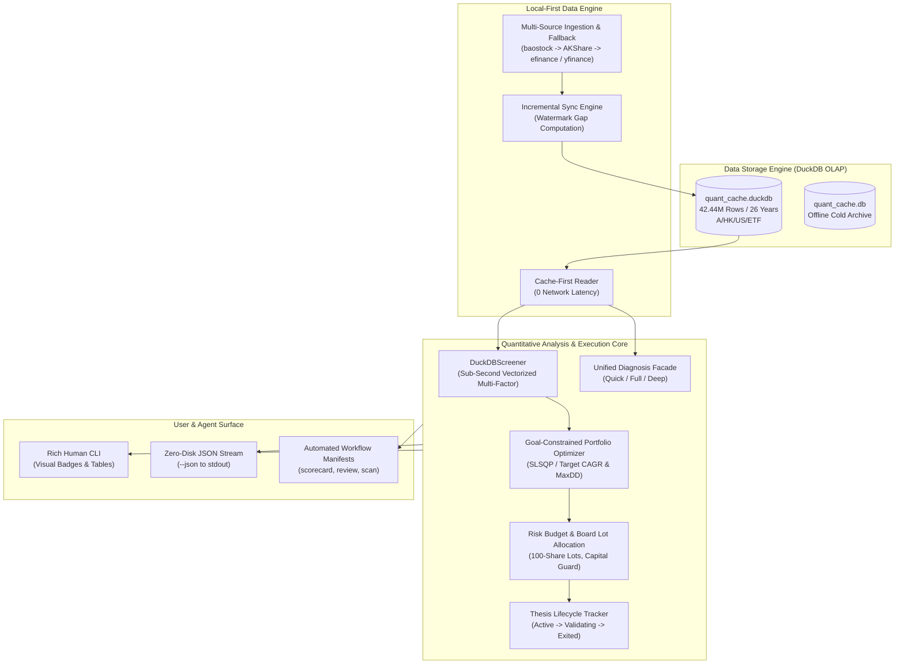

# stockaskill Documentation | 文档中心

[English](./en/README.md) | [简体中文](./zh/README.md)

---

Welcome to the documentation portal for **stockaskill** — an offline-first, full-data-driven quantitative decision and investment analysis engine powered by **DuckDB** (42.44M rows across A/HK/US/ETF markets over 26 years).

欢迎查阅 **stockaskill** 文档中心。本项目是一个基于 **DuckDB** 打造的本地优先、离线全量数据驱动的量化决策与投资分析引擎（内置跨 A/港/美/ETF 四大市场 26 年历史周期的 4,244 万行高质量数据）。

---

## Documentation Structure / 文档导航

```
docs/
├── README.md                      # This navigation portal / 本导航中心
├── zh/                            # 简体中文文档
│   ├── README.md                  # 核心功能全景手册与架构设计
│   ├── data-strategy.md           # DuckDB 本地优先与增量同步数据策略
│   └── cli-reference.md           # 命令行参数详解与智能体工具字典
└── en/                            # English Documentation
    ├── README.md                  # System Overview & Architecture Manual
    ├── data-strategy.md           # DuckDB Local-First & Incremental Sync Strategy
    └── cli-reference.md           # CLI Command Reference & Agent Tool Guide
```

---

## Quick Navigation / 快速直达

### 🇨🇳 简体中文文档
1. [功能全景手册与系统架构 (zh/README.md)](./zh/README.md)
   - 系统定位、核心定量能力、7+1 多因子策略体系、目标约束组合优化、投资论据全生命周期跟踪。
2. [DuckDB 本地优先数据策略 (zh/data-strategy.md)](./zh/data-strategy.md)
   - 4,244 万行 DuckDB OLAP 引擎架构、表结构与物理存储设计、增量水位线同步、多源熔断降级。
3. [CLI 命令与智能体工具参考 (zh/cli-reference.md)](./zh/cli-reference.md)
   - 包含 `--json` 标准流式工具调用、选股-优化-跟踪一键闭环流水线、单股多级诊断门面等全量命令说明。

### 🇬🇧 English Documentation
1. [System Overview & Architecture (en/README.md)](./en/README.md)
   - System positioning, core quantitative capabilities, multi-factor models, goal-constrained portfolio optimization, thesis lifecycle management.
2. [DuckDB Local-First Data Strategy (en/data-strategy.md)](./en/data-strategy.md)
   - 42.44M-row DuckDB OLAP columnar architecture, physical schema, dynamic incremental watermark sync, and multi-source resilience.
3. [CLI Reference & Agent Tools (en/cli-reference.md)](./en/cli-reference.md)
   - Complete command options, `--json` streaming tool calling specifications, closed-loop pipelines, and single-stock diagnosis facade.

---

## System Architecture / 系统架构全景


