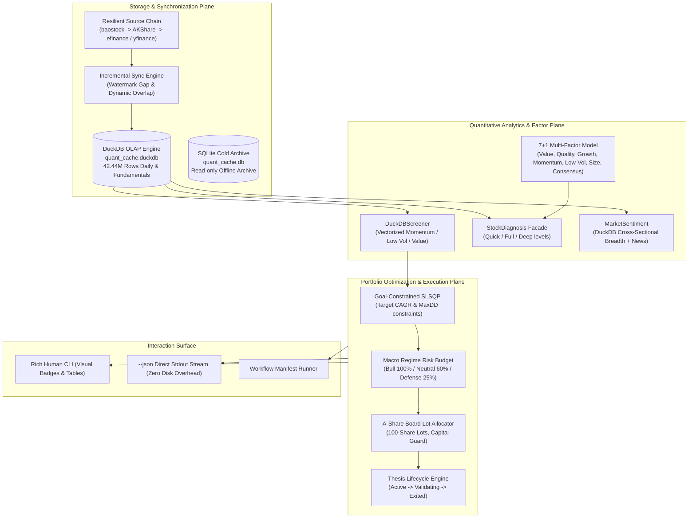

# stockaskill System Overview & Architecture Manual

> **Version**: 2.1.0  
> **Core Engine**: DuckDB OLAP Columnar Store (42.44 Million rows across 26 years)  
> **Python Runtime**: Python 3.10+  
> **Supported Markets**: China A-Shares / Hong Kong / US Equities / ETFs (`FUND`)

---

## 1. System Positioning & Core Value

**stockaskill** is an **offline-first, full-data-driven quantitative decision and investment analysis engine**. Designed to eliminate common industry pitfalls such as API rate exhaustion (`RemoteDisconnected`), sluggish full-market historical re-downloads, and execution disconnects, stockaskill provides a production-grade quantitative workflow:

- **Massive Historical Data Foundation**: 42.44 million rows of daily OHLCV and fundamental metrics spanning 26 years across China A-shares, Hong Kong, US equities, and ETFs, backed by the high-performance columnar engine DuckDB (`quant_cache.duckdb`).
- **Strictly Local-First**: Remote APIs are exclusively synchronization mechanisms, never query layers. All screening, factor scoring, and portfolio optimization run 100% locally with 0 network latency.
- **Sub-Second Vectorized Cross-Sectional Screening**: Utilizing DuckDB OLAP window functions and vectorized execution, cross-sectional factor ranking across thousands of stocks completes in **0.2 ~ 0.5 seconds**.
- **Goal-Constrained Modern Portfolio Optimization**: Solves optimal Sharpe weights under dual hard constraints: Target CAGR and Maximum Drawdown (MaxDD) using SLSQP, automatically generating trade tickets rounded to 100-share board lots.
- **One-Shot Closed-Loop Pipeline**: A single command performs `cross-sectional screening -> portfolio optimization -> risk-budgeted board-lot sizing -> thesis lifecycle tracking`.
- **Agent-First Native Integration**: All commands support `--json` direct streaming to stdout, allowing AI Agents (Claude Code, OpenCode, Codex, OpenClaw, Cursor, Windsurf) to consume structured outputs without intermediate disk reads.

---

## 2. High-Level System Architecture



---

## 3. Core Capabilities & Workflows

### 3.1 Vectorized Cross-Sectional Screening & Closed-Loop Pipeline (`screen`)

Traditional stock screening iterating over thousands of stocks via HTTP downloads takes 30+ minutes. `screen` executes vectorized SQL queries directly on DuckDB columnar storage in milliseconds.

#### Available Presets
- `momentum_enhanced` (default): High-momentum leaders with 20/60/120-day trend confirmation and volume breakout.
- `low_vol` / `low_volatility`: Low-volatility defensive stocks suitable for volatile/bearish market environments.
- `deep_value` / `value`: Undervalued stocks protected by high Piotroski F-Scores.
- `balanced`: Multi-factor balanced model combining momentum, quality, and valuation.

#### One-Shot Pipeline: Screening to Portfolio & Tracking
With `--to-portfolio` and `--track`, the system automatically screens candidates, solves the SLSQP constrained optimization, allocates 100-share board lots, and saves thesis records for automated daily tracking:

```bash
# Screen -> Optimize -> Allocate 1,000,000 capital in board lots -> Track thesis
python skills/stockaskill/scripts/run.py screen \
  --market A \
  --preset momentum_enhanced \
  --top 5 \
  --to-portfolio \
  --capital 1000000 \
  --track
```

---

### 3.2 Goal-Constrained Portfolio Optimization (`portfolio`)

Provides mathematical programming-based portfolio allocation rather than naive equal weights or inverse-volatility sizing.

- **Hard Constraints**:
  - `--target-cagr`: Target annualized compound growth rate (e.g., 0.12 for 12%).
  - `--max-drawdown`: Maximum historical drawdown tolerance (e.g., 0.08 for 8%).
- **Market Regime Risk Budgeting**:
  - Dynamically adjusts overall equity exposure based on market posture: Bull (100%), Neutral (60%), Defensive (25%).
- **Board Lot Sizing (100-Share Lots)**:
  - Automatically rounds theoretical allocations down to 100-share board lots.
  - Ensures `shares * price <= allocated_capital`, with remaining funds safely pooled in unallocated cash.

```bash
python skills/stockaskill/scripts/run.py portfolio \
  --optimize \
  --codes 600519,000858,601318,300750 \
  --target-cagr 0.12 \
  --max-drawdown 0.08 \
  --capital 1000000 \
  --market A
```

---

### 3.3 Unified Single-Stock Diagnosis Facade (`diagnose`)

Consolidates fragmented analysis commands into a clean facade controlled by `--level`:

| Level (`--level`) | Covered Dimensions | Typical Use Case | Latency |
|:---|:---|:---|:---|
| `quick` | K-line summary, PE/PB/ROE, Piotroski F-Score, Multi-factor score | Rapid screening, watchlist check | < 0.2s |
| `full` (default) | 7-strategy signals, EastMoney sentiment, macro risk budget | Pre-trade signal confirmation | ~ 1.0s |
| `deep` | Multi-horizon trend, conflict matrix, bull/bear cases, thesis conditions | Core thesis generation, research reports | ~ 2.0s |

```bash
# Quick health check (equivalent to legacy analyze)
python skills/stockaskill/scripts/run.py diagnose 600519 --level quick

# Full strategy and sentiment check (standard mode)
python skills/stockaskill/scripts/run.py diagnose 600519 --level full

# In-depth multi-scenario research thesis (equivalent to legacy deep-diagnose)
python skills/stockaskill/scripts/run.py diagnose 600519 --level deep
```

> **Backward Compatibility**: Top-level commands `analyze <code>` and `deep-diagnose <code>` are preserved as permanent aliases.

---

### 3.4 Dynamic Incremental Synchronization (`sync`)

Operates under the strict **"Local-First, Fetch on Miss"** doctrine:

1. **Watermark-Driven Gap Tracking**: Reads `sync_watermarks` to determine the latest cached date per symbol.
2. **Safe Overlap Backfill**: Starts fetching from `last_cached_date - 3 trading days` to handle holiday adjustments and late post-market corrections.
3. **Resilient Multi-Source Fallback**: Baostock as primary for A-shares, AKShare and efinance as secondary; yfinance as secondary for HK/US.
4. **ETF-First Semantics**: The `FUND` pipeline focuses on highly liquid broad-market and sector ETFs.

```bash
# Incrementally update a symbol
python skills/stockaskill/scripts/run.py sync update 600519 --market A

# Verify symbol data readiness
python skills/stockaskill/scripts/run.py status data symbol 600519 --market A

# Inspect DuckDB storage health and row counts
python skills/stockaskill/scripts/run.py cache stats
```

---

### 3.5 Thesis Lifecycle Tracking (`thesis`)

Quantitative investing demands accountability. The Thesis module manages investment theses from entry to exit:

- **`capture`**: Records entry rationale, bull case, bear case, and explicit **invalidation conditions**.
- **`track`**: Daily automated check verifying whether invalidation triggers (e.g. 20-day moving average breakdown, valuation stretch) have occurred.
- **`postmortem`**: Archives retrospective learning upon exit.

```bash
# Capture a thesis
python skills/stockaskill/scripts/run.py thesis capture 600519 --market A --notes "Breakout confirmed above MA60"

# List active theses
python skills/stockaskill/scripts/run.py thesis list --market A

# Check invalidation conditions
python skills/stockaskill/scripts/run.py thesis track 600519 --market A
```

---

## 4. Native Agent Integration (`--json`)

To enable seamless integration with modern AI coding and reasoning agents (Claude Code, OpenCode, Codex, OpenClaw, Cursor, Windsurf), every stockaskill command supports `--json`.

### Advantages
- **Direct Stdout Streaming**: Outputs JSON directly to stdout without generating temporary report files on disk, cutting context token usage and I/O latency by over 50%.
- **Zero Output Pollution**: Progress bars, colored badges, and terminal text are silenced, ensuring clean `json.loads(stdout)` parsing.

```bash
# Agent tool invocation examples
python skills/stockaskill/scripts/run.py screen --market A --preset low_vol --top 5 --json
python skills/stockaskill/scripts/run.py diagnose 600519 --level quick --json
```
