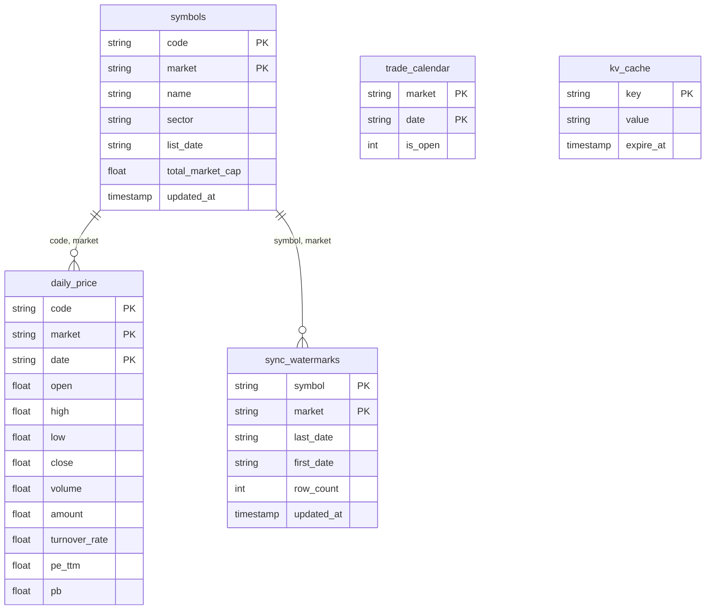

# DuckDB Local-First & Dynamic Incremental Sync Specification

> **Version**: 2.1.0  
> **Primary Storage Engine**: DuckDB (`quant_cache.duckdb`)  
> **Cold Archive**: SQLite (`quant_cache.db`, untouched read-only archive)

---

## 1. Architectural Evolution

In quantitative decision engines, storage architecture and data synchronization patterns determine query speed, operational cost, and overall stability.

### The Evolution from SQLite to DuckDB Columnar Store

In earlier versions, SQLite (`quant_cache.db`) was used. As historical coverage grew to **42.44 million rows** across 26 years of A-shares, Hong Kong, US equities, and ETFs, row-oriented limitations emerged:
- **Row-Oriented I/O Overhead**: Computing cross-sectional factors (e.g., 20/60-day returns, volatility distributions) required reading all columns of every row from disk into memory, resulting in multi-second or minute-long delays.
- **Concurrency & OLAP Bottlenecks**: SQLite's table/database lock model and lack of native vectorized execution limited parallel analytics.

**Advantages of DuckDB**:
1. **Columnar Storage**: Scans only the relevant columns (`code`, `date`, `close`, `market`), reducing disk I/O by 70% to 90%.
2. **Vectorized Execution**: Processes data in SIMD-aligned vector chunks, scanning millions of rows per core per second. Cross-sectional multi-factor screening across 5,000+ symbols drops to **0.2 ~ 0.5 seconds**.
3. **Rich Analytical Window Functions**: Moving averages, historical quantiles, and lags execute directly inside DuckDB, avoiding heavy serialization into Python Pandas objects.

> **Storage Policy**:
> - **`quant_cache.duckdb`**: The sole active analytical and storage database handling all reads, writes, and optimizations.
> - **`quant_cache.db`**: Preserved strictly as an offline cold archive file.

---

## 2. Physical Database Schema



### Table Definitions

#### 1. Daily Prices (`daily_price`)
```sql
CREATE TABLE IF NOT EXISTS daily_price (
    code            VARCHAR NOT NULL,
    market          VARCHAR NOT NULL,
    date            VARCHAR NOT NULL,
    open            DOUBLE,
    high            DOUBLE,
    low             DOUBLE,
    close           DOUBLE,
    volume          DOUBLE,
    amount          DOUBLE,
    turnover_rate   DOUBLE,
    pe_ttm          DOUBLE,
    pb              DOUBLE,
    PRIMARY KEY (code, market, date)
);
```

#### 2. Symbol Universe (`symbols` & `stock_pool`)
```sql
CREATE TABLE IF NOT EXISTS symbols (
    code             VARCHAR NOT NULL,
    market           VARCHAR NOT NULL,
    name             VARCHAR,
    sector           VARCHAR,
    industry         VARCHAR,
    list_date        VARCHAR,
    total_market_cap DOUBLE,
    is_active        BOOLEAN DEFAULT true,
    updated_at       TIMESTAMP DEFAULT CURRENT_TIMESTAMP,
    PRIMARY KEY (code, market)
);
```

#### 3. Watermarks (`sync_watermarks`)
Tracks the exact date range currently stored for each symbol, enabling precise incremental gap detection.
```sql
CREATE TABLE IF NOT EXISTS sync_watermarks (
    symbol      VARCHAR NOT NULL,
    market      VARCHAR NOT NULL,
    last_date   VARCHAR NOT NULL,
    first_date  VARCHAR,
    row_count   BIGINT DEFAULT 0,
    updated_at  TIMESTAMP DEFAULT CURRENT_TIMESTAMP,
    PRIMARY KEY (symbol, market)
);
```

#### 4. Trade Calendar (`trade_calendar`) & Auto-Healing
Records trading dates and holidays. Built-in auto-healing (`_heal_calendar_tail`) fills recent calendar gaps using weekday rules and actual closing prices to prevent calendar stale errors.

#### 5. Ephemeral Key-Value Cache (`kv_cache`)
Caches short-lived data such as EastMoney Guba sentiment metrics and market breadth with TTL-based expiration.

---

## 3. Core Local-First Principles

```
      +-----------------------------------------+
      |       Application / Screener / Tool     |
      +--------------------+--------------------+
                           | Read request (code, start_date, end_date)
                           v
      +--------------------+--------------------+
      |            DataEngine Orchestrator      |
      |                                         |
      |  1. Read local DuckDB (quant_cache.duckdb)|
      |  2. Hit -> Return immediately (0 net IO) |
      |  3. Miss/Stale -> Compute missing range  |
      +--------------------+--------------------+
                           | Fetch missing range only (last_date - 3)
                           v
      +--------------------+--------------------+
      |        Multi-Source Resilient Ingestion |
      |  Baostock -> AKShare -> efinance/yfinance|
      |  Strict Validation (negative price check)|
      +--------------------+--------------------+
                           | UPSERT (ON CONFLICT DO UPDATE)
                           v
      +--------------------+--------------------+
      |          Persist into DuckDB            |
      +-----------------------------------------+
```

### Principle 1: Local-First, Fetch on Miss
The local DuckDB database is the single source of truth. Remote APIs serve solely as synchronization pipes, never direct query targets.

### Principle 2: Incremental by Default
- **Cold Start**: Seeds symbols from safe baselines (A-Shares: `2000-01-01`, HK: `1995-01-01`, US: `1990-01-01`).
- **Incremental Sync**: Consults `sync_watermarks` to determine the missing date interval `[last_cached_date, today]`. Only requests date-range-aware endpoints (e.g. `ak.stock_zh_a_hist(symbol, start_date, end_date)`). Full-history downloads on cached symbols are strictly forbidden.

### Principle 3: Overlap on Incremental Fetch
When backfilling, the fetch range starts from `last_cached_date - 3 trading days`. This guarantees:
- Absorption of weekend, holiday, and daylight-saving date discrepancies;
- Capture of late post-market adjustments and ex-dividend corporate actions.
Writes use `ON CONFLICT (code, market, date) DO UPDATE` semantics.

### Principle 4: Validate Before Cache
Raw data from remote APIs must pass quality checks before ingestion:
- Reject negative or zero prices (`open`, `high`, `low`, `close` must be > 0);
- Reject malformed bars where `high < low`;
- Reject future dates beyond the current date;
- Reject negative volume or turnover.

---

## 4. Multi-Source Resiliency & Circuit Breakers

To protect against API rate limits (HTTP 429) and upstream server disruptions:

| Data Type | Primary Source | Fallback 1 | Fallback 2 | Degradation Policy |
|:---|:---|:---|:---|:---|
| **A-Share Daily OHLCV** | **Baostock** (reliable connection, no rate limit) | AKShare (EastMoney) | efinance | Degrade to cached history on complete failure |
| **A-Share Fundamentals** | THS Financial Indicators | Sina Finance | EastMoney Web | Fall back to historical medians |
| **HK / US Equities** | AKShare Global | yfinance | — | Focus on liquid market leaders |
| **ETFs (`FUND`)** | AKShare Fund History | EastMoney ETF Index | — | ETF-first semantics, high liquidity only |

### Circuit Breaker Behavior
- If an upstream source fails 3 consecutive times, it is placed in a 300-second cooldown period, during which traffic is immediately redirected to fallback sources.
- If all sources fail, the command logs a warning and gracefully degrades to cached data without crashing.
