# stockaskill Hands-On Tutorial: From Getting Started to End-to-End Quant Decision Pipelines

> **Audience**: Quantitative Researchers, Individual Investors, and AI Agent Developers  
> **Core Engine**: DuckDB Columnar OLAP Engine (42.44 Million Rows across A/HK/US/ETF Markets)  
> **Runtime Environment**: Python >= 3.10 | Windows / macOS / Linux Supported  
> **Companion Guides**: [System Overview & Architecture](README.md) | [CLI Reference](cli-reference.md) | [Data Strategy Specification](data-strategy.md)

---

## Table of Contents

1. [Project Overview & Design Philosophy](#1-project-overview--design-philosophy)
2. [Environment Setup & Quick Installation](#2-environment-setup--quick-installation)
3. [Local Data Maintenance & Incremental Sync](#3-local-data-maintenance--incremental-sync)
4. [Multi-Dimensional Single-Stock Diagnosis](#4-multi-dimensional-single-stock-diagnosis)
5. [Sub-Second Vectorized Multi-Factor Screening](#5-sub-second-vectorized-multi-factor-screening)
6. [Goal-Constrained Portfolio Optimization & Board Lot Sizing](#6-goal-constrained-portfolio-optimization--board-lot-sizing)
7. [End-to-End Quant Decision Pipeline](#7-end-to-end-quant-decision-pipeline)
8. [Thesis Lifecycle Tracking & Dynamic Risk Monitoring](#8-thesis-lifecycle-tracking--dynamic-risk-monitoring)
9. [AI Agent Integration & Automation Protocol](#9-ai-agent-integration--automation-protocol)
10. [Production Best Practices & Troubleshooting](#10-production-best-practices--troubleshooting)

---

## 1. Project Overview & Design Philosophy

In conventional quantitative research and algorithmic investing, analysts and AI agents typically suffer from three fundamental bottlenecks:
1. **API Rate Limits and Frequent Disconnections**: Repeated full-history downloads trigger API throttling, IP bans, or `RemoteDisconnected` socket errors.
2. **Sluggish Computational Latency**: Iterative loops or thread-pool overhead evaluating 5,000+ stocks take minutes per screening run.
3. **Execution Disconnect**: Theoretical mean-variance weights ignore market reality, such as A-share 100-share board lot constraints, macro risk budgeting, and active trailing stop-loss enforcement.

**stockaskill** addresses these bottlenecks with a modern quantitative engineering architecture:

```mermaid
flowchart LR
    subgraph S1["01 · DATA FOUNDATION"]
        direction TB
        D1[("DuckDB OLAP Engine<br/>42.44M Rows · 26-Year Base<br/>A / HK / US / ETF")]
        D2["Dynamic Incremental Sync<br/>sync update<br/>Watermark Gap Backfill"]
        D3["Trade Calendar Healing<br/>Quality Circuit Breakers"]
        D2 --> D1
        D3 --> D1
    end

    subgraph S2["02 · ALPHA SCREENING"]
        direction TB
        A1["Vectorized Screener<br/>screen · 0.5s Full-Market<br/>Columnar SIMD Scanning"]
        A2["7+1 Multi-Factor Model<br/>Value · Quality · Growth<br/>Momentum · Low-Vol · Size"]
        A3["Multi-Level Diagnosis<br/>diagnose<br/>quick / full / deep"]
        A2 -.-> A1
        A1 -.-> A3
    end

    subgraph S3["03 · PORTFOLIO & EXECUTION"]
        direction TB
        P1["SLSQP Convex Optimizer<br/>portfolio --optimize<br/>Dual Target CAGR & MaxDD"]
        P2["Macro Risk Budgeting<br/>Bull: 100% · Neutral: 60%<br/>Defensive: 25%"]
        P3["100-Share Board Lot Sizing<br/>Trade Execution Tickets<br/>Cash Buffer Guard"]
        P2 -.-> P1
        P1 --> P3
    end

    subgraph S4["04 · THESIS & AGENT LOOP"]
        direction TB
        T1["Thesis Lifecycle Tracker<br/>thesis capture<br/>Active -> Review -> Exit"]
        T2["Dynamic Risk Patrol<br/>risk-alert<br/>Trailing Stop-Loss Patrol"]
        T3["Agent Zero-Disk Stream<br/>--json to stdout<br/>AgentSkills.io Protocol"]
        T1 --> T2
        T1 -.-> T3
    end

    D1 ===>|"0-Latency OLAP"| A1
    A1 ===>|"Top-K Candidates"| P1
    P3 ===>|"Execution Orders"| T1

    classDef dataNode fill:#0b192c,stroke:#008dda,stroke-width:2px,color:#e0f2fe;
    classDef alphaNode fill:#1a103c,stroke:#7952b3,stroke-width:2px,color:#ede9fe;
    classDef execNode fill:#06281e,stroke:#00b894,stroke-width:2px,color:#d1fae5;
    classDef loopNode fill:#281605,stroke:#e17055,stroke-width:2px,color:#fef3c7;

    class D1,D2,D3 dataNode;
    class A1,A2,A3 alphaNode;
    class P1,P2,P3 execNode;
    class T1,T2,T3 loopNode;

    style S1 fill:#060d17,stroke:#008dda,stroke-width:1.5px,color:#93c5fd;
    style S2 fill:#0f0923,stroke:#7952b3,stroke-width:1.5px,color:#c4b5fd;
    style S3 fill:#03140f,stroke:#00b894,stroke-width:1.5px,color:#6ee7b7;
    style S4 fill:#140b03,stroke:#e17055,stroke-width:1.5px,color:#fde68a;
```



- **Local-First Source of Truth**: Powered by an offline 42.44M-row DuckDB columnar engine spanning 26 years across A-share, HK, US, and ETF markets, delivering 0 network latency.
- **Dynamic Incremental Synchronization**: Never downloads full market history blindly; inspects local watermarks and retrieves missing date windows with safety overlap.
- **Strict Engineering Constraints**: Formulates optimization with dual rigid constraints on Target CAGR and Maximum Drawdown, outputting ready-to-execute board lot tickets.

---

## 2. Environment Setup & Quick Installation

### 2.1 Prerequisites

This project requires **Python >= 3.10**. We strongly recommend using `uv` or Python's native `venv`.

```bash
# 1. Clone the repository
git clone https://github.com/axjing/stockaskill.git
cd stockaskill

# 2. Create and activate a virtual environment (uv recommended)
uv venv --python 3.10
# Windows PowerShell
.venv\Scripts\activate
# Linux / macOS
source .venv/bin/activate

# 3. Install dependencies in editable mode
uv pip install -e .
```

### 2.2 Verify Storage Engine & Cache State

Once installed, confirm that DuckDB is active and inspect the offline dataset:

```bash
# Check current active storage engine (confirm DuckDB)
uv run python skills/stockaskill/scripts/run.py cache engine

# Inspect local row statistics and market coverage
uv run python skills/stockaskill/scripts/run.py cache stats
```

Expected output:
```text
Storage Engine: DuckDB
Database Path: D:\CODE\stockaskill\skills\stockaskill\scripts\quant_cache.duckdb
Status: Healthy

Cache Statistics:
  daily_price: 42,442,180 rows
  financial_indicator: 186,432 rows
  stock_pool: 5,421 rows
  trade_calendar: 8,920 rows
```

---

## 3. Local Data Maintenance & Incremental Sync

Prior to running quantitative screens or portfolio optimizations, ensure that the target symbols have up-to-date data.

### 3.1 Inspect Data Freshness (`status data`)

`status data` performs a zero-network check on cached history and fundamental streams:

```bash
# Inspect single symbol freshness
uv run python skills/stockaskill/scripts/run.py status data symbol 600519 --market A

# Inspect watchlist scope freshness
uv run python skills/stockaskill/scripts/run.py status data watchlist --market A
```

The output displays row counts, latest covered trading date, and TTL status (`fresh` / `stale`).

### 3.2 Dynamic Incremental Sync (`sync update`)

When a symbol requires backfilling, execute `sync update`. The engine computes the exact watermark gap and fetches only the missing bars (including a 3-day overlap window):

```bash
# Incrementally update a single symbol
uv run python skills/stockaskill/scripts/run.py sync update 600519 --market A

# Incrementally update the entire watchlist
uv run python skills/stockaskill/scripts/run.py sync update --scope watchlist --market A
```

> [!TIP]
> `sync update` automatically aligns the diagnostic `sync_state` table and updates local factor snapshots, keeping diagnostic commands 100% synchronized.

### 3.3 Quality Auditing & Tiered Repairs (`sync check` & `sync repair`)

```bash
# Run data quality audit on watchlist candidates
uv run python skills/stockaskill/scripts/run.py sync check --market A --codes 600519,000858

# If anomalies are detected, execute circuit-breaker repairs
uv run python skills/stockaskill/scripts/run.py sync repair --market A --codes 600519 --data-kinds history,fundamentals
```

---

## 4. Multi-Dimensional Single-Stock Diagnosis

Analyze target assets across fundamentals, valuation, momentum, and financial safety.

### 4.1 Unified Diagnosis Facade (`diagnose`)

The unified diagnostic entry point supports `--level quick|full|deep`:

```bash
# 1. Quick Diagnosis (quick: core factor scores, latency ~0.1s)
uv run python skills/stockaskill/scripts/run.py diagnose 600519 --market A --level quick

# 2. Full Diagnosis (full: default level with 7-factor radar and financial health)
uv run python skills/stockaskill/scripts/run.py diagnose 600519 --market A --level full

# 3. Deep Diagnosis (deep: long-form report with valuation percentiles and peer analysis)
uv run python skills/stockaskill/scripts/run.py diagnose 600519 --market A --level deep
```

### 4.2 Scorecard Evaluation (`scorecard`)

Evaluate investment quality through transparent heuristic scorecards:

```bash
uv run python skills/stockaskill/scripts/run.py scorecard diagnose 600519 --market A
```

---

## 5. Sub-Second Vectorized Multi-Factor Screening

One of stockaskill's defining capabilities is **sub-second vectorized cross-sectional screening (`screen`)** powered by DuckDB OLAP window functions.

### 5.1 Built-in Strategy Presets

The engine provides battle-tested factor presets for the A-share market:

| Preset (`--preset`) | Core Strategy Logic | Best Market Regime |
|---------------------|---------------------|--------------------|
| `momentum_enhanced` | Trend momentum + MA alignment + quality filter | Bull trending regime |
| `low_vol` | Low volatility anomaly + robust yield / defensiveness | Sideways or defensive regime |
| `deep_value` | Low valuation (PE/PB) + high Piotroski F-Score | Market bottoms / mean reversion |
| `quality_growth` | High ROE/ROIC + steady revenue/earnings growth | Core asset expansion |

Example commands:

```bash
# Screen top 10 defensive stocks using the low-volatility preset
uv run python skills/stockaskill/scripts/run.py screen --market A --preset low_vol --top 10

# Screen top 5 trend momentum leaders
uv run python skills/stockaskill/scripts/run.py screen --market A --preset momentum_enhanced --top 5
```

The screening engine processes all 5,400+ A-share stocks in **0.2 to 0.5 seconds**, rendering a formatted terminal table with factor breakdowns.

### 5.2 Custom Factor Weighting

To implement bespoke multi-factor formulas, pass custom weights directly:

```bash
uv run python skills/stockaskill/scripts/run.py screen --market A \
  --value-weight 0.2 \
  --quality-weight 0.3 \
  --momentum-weight 0.3 \
  --growth-weight 0.2 \
  --top 8
```

---

## 6. Goal-Constrained Portfolio Optimization & Board Lot Sizing

Selecting top stocks is only half the battle; risk-budgeted position sizing determines long-term survivability.

`portfolio --optimize` leverages the **SLSQP convex optimization solver** to maximize the Sharpe ratio subject to rigid user constraints on Target CAGR and Maximum Drawdown, automatically sizing positions into valid 100-share board lots.

### 6.1 Running Goal-Constrained Optimization

```bash
# Solve optimal allocation for 5 stocks with Target CAGR=12%, Max Drawdown=6%, Capital=500k CNY
uv run python skills/stockaskill/scripts/run.py portfolio \
  --codes 600519,000858,601318,600036,002475 \
  --market A \
  --optimize \
  --target-cagr 0.12 \
  --max-drawdown 0.06 \
  --capital 500000
```

### 6.2 Interpreting Solver Output

The optimizer provides:
1. **Macro Regime Risk Budget**: Allocates total equity exposure according to market regime (e.g., Bull 100%, Neutral 60%, Defensive 25%).
2. **Theoretical Optimal Weights**: Mathematical allocations satisfying CAGR >= 12% and MaxDD <= 6%.
3. **Board Lot Execution Tickets**:
   - Quantized into exact 100-share multiples (e.g., 200 shares of 600519, 800 shares of 000858).
   - Computes capital committed per position and leftover cash buffer.
   - Ready for direct entry into brokerage platforms without odd-lot errors.

---

## 7. End-to-End Quant Decision Pipeline

stockaskill enables end-to-end chaining of screening, portfolio optimization, and order ticket generation:

```mermaid
sequenceDiagram
    autonumber
    actor User as User / AI Agent
    participant Screen as screen Engine
    participant Opt as portfolio Optimizer
    participant Alloc as Board Lot Allocator
    participant Thesis as Thesis Store

    User->>Screen: Run preset screening (screen --preset low_vol --top 5)
    Screen-->>Opt: Pipe Top 5 candidate tickers
    Opt->>Opt: SLSQP solver (Target CAGR & MaxDD)
    Opt->>Alloc: Pass weights + total capital
    Alloc-->>Thesis: Generate board lot tickets & log entry stops
    Thesis-->>User: Return actionable orders & risk parameters
```

Step-by-step workflow:
1. Run `screen` to select the top 5 candidates:
   ```bash
   uv run python skills/stockaskill/scripts/run.py screen --market A --preset low_vol --top 5 --json
   ```
2. Pipe the selected tickers into the portfolio optimizer:
   ```bash
   uv run python skills/stockaskill/scripts/run.py portfolio \
     --codes 600036,601328,601988,601288,601398 \
     --market A \
     --optimize \
     --target-cagr 0.08 \
     --max-drawdown 0.04 \
     --capital 1000000
   ```

---

## 8. Thesis Lifecycle Tracking & Dynamic Risk Monitoring

Disciplined trade tracking and systematic postmortems prevent behavioral errors.

### 8.1 Log Entry Thesis (`thesis capture`)

Record trade rationale, entry pricing, and catalysts:

```bash
uv run python skills/stockaskill/scripts/run.py thesis capture 600519 \
  --market A \
  --notes "Defensive blue-chip allocation; dividend yield > 3.5%; awaiting valuation mean-reversion" \
  --catalyst "Q3 earnings momentum"
```

### 8.2 Daily Position & Risk Alerts (`risk-alert`)

Run automated risk monitoring across all active holdings:

```bash
# Scan active positions for trailing stop-loss violations
uv run python skills/stockaskill/scripts/run.py risk-alert --market A
```

Triggers clear warnings whenever a position breaches trailing stop levels (e.g., -5%) or reaches profit targets.

### 8.3 Trade Postmortems (`thesis postmortem`)

Upon exiting positions, log outcomes and performance attribution:

```bash
uv run python skills/stockaskill/scripts/run.py thesis postmortem \
  --code 600519 \
  --market A \
  --outcome win \
  --return-pct 15.2 \
  --notes "Exited at target resistance level"
```

---

## 9. AI Agent Integration & Automation Protocol

stockaskill natively complies with the [AgentSkills.io Specification](https://agentskills.io/home), architected specifically for LLM Tool Calling.

### 9.1 Zero-Disk `--json` Streaming

Appending `--json` suppresses terminal visual formatting and emits strict, schema-compliant JSON to `stdout`:

```bash
uv run python skills/stockaskill/scripts/run.py screen --market A --preset low_vol --top 3 --json
```

Output:
```json
{
  "market": "A",
  "preset": "low_vol",
  "total_screened": 5421,
  "top_count": 3,
  "stocks": [
    {
      "code": "600036",
      "name": "China Merchants Bank",
      "composite_score": 0.884,
      "volatility_score": 0.92,
      "pe": 5.8,
      "pb": 0.72
    }
  ]
}
```

Agents parse standard output directly with zero disk I/O overhead.

### 9.2 Plug-and-Play Framework Compatibility

Deploy the `stockaskill/` directory into your agent framework:

- **Claude Code**: `~/.claude/skills/stockaskill/`
- **OpenCode**: `~/.config/opencode/skills/stockaskill/`
- **Cursor / Windsurf**: Add rules into `.cursor/rules/`
- **Codex / OpenClaw**: Automatically loads via `SKILL.md`

In natural language conversation with the agent:
> *"Use the low-volatility preset to screen 5 stocks in market A, then optimize a 300,000 CNY portfolio targeting 10% CAGR and max 5% drawdown with board lot tickets."*

The Agent automatically chains `screen` and `portfolio --optimize` with `--json` and returns the final execution schedule.

---

## 10. Production Best Practices & Troubleshooting

### Best Practice 1: Always Read Local First; Avoid Blind Full Downloads
Never initiate unbounded full-market downloads without scope limits. Use `sync update` for incremental daily backfills.

### Best Practice 2: Handling DuckDB Single-Process Write Locks
DuckDB enforces strict single-process write locking. If you encounter:
`IOException: Cannot open file ... File is already open in PID xxxxx`
A background synchronization or check process is active. Wait for the background task to complete or terminate the process holding the lock before launching a new command.

### Best Practice 3: Trade Calendar Auto-Healing
The engine features autonomous calendar healing. If the local calendar lags behind by more than 7 days, it automatically refreshes trade dates from Sina Finance during the next read operation.

---

### Next Steps & Further Reading
- [DuckDB Local-First Data Strategy](data-strategy.md): In-depth table schemas and columnar layouts.
- [CLI Reference Manual](cli-reference.md): Exhaustive parameter reference for all subcommands.
