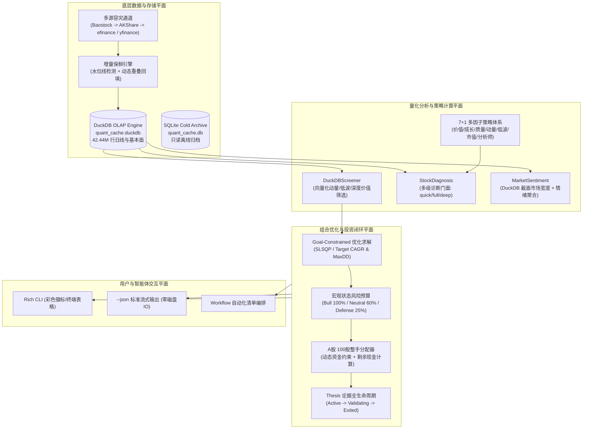

# stockaskill 核心功能全景手册与架构指南

> **版本**: 2.1.0  
> **核心引擎**: DuckDB OLAP Columnar Engine (4,244 万行数据，跨 26 年历史周期)  
> **语言支持**: Python 3.10+  
> **支持市场**: A 股 / 港股 / 美股 / ETF (`FUND`)

---

## 1. 系统定位与核心价值

**stockaskill** 是一个**离线全量数据驱动、本地优先的量化投资决策与分析引擎**。针对传统量化脚本易出现的接口限频（RemoteDisconnected）、全量重拉慢、策略与执行割裂等痛点，stockaskill 建立了现代量化工程体系：

- **海量全量历史底座**：内置跨 A 股、港股、美股、ETF 26 年周期的 4,244 万行日级全量行情与基本面指标，存储于高性能列式引擎 DuckDB（`quant_cache.duckdb`）。
- **真正的本地优先（Local-First）**：绝不无节制请求远程 API。分析、选股、因子计算、策略回测 100% 优先在本地内存/DuckDB 执行，实现 0 网络时延与毫秒级反馈。
- **亚秒级向量化多因子截面选股**：基于 DuckDB OLAP 窗口函数与向量化计算，从数千只股票的全历史截面中筛选优质标的仅需 0.2~0.5 秒。
- **目标约束现代组合优化**：基于 SLSQP 数学规划，在目标年化收益率（Target CAGR）与最大回撤（Max Drawdown）双重刚性约束下求解最佳夏普权重，并自动按 A 股 100 股整手（Board Lot）生成交易票据。
- **一键闭环决策流水线**：单条指令实现 `截面选股 -> 组合优化求解 -> 风险预算整手分配 -> 投资论据持久化跟踪` 的全自动化闭环。
- **智能体原生协同（Agent-First）**：所有 CLI 命令支持 `--json` 直接输出标准化 JSON 数据流至标准输出（stdout），智能体工具调用无需磁盘中间文件二次读取解析。

---

## 2. 系统架构全景



---

## 3. 核心功能与工作流详解

### 3.1 向量化截面选股与全自动闭环流水线 (`screen`)

传统遍历全市场逐只下载计算股票需要数十分钟，而 `screen` 直接利用 DuckDB 列式引擎的向量化算子，在几百毫秒内完成全市场计算与排序。

#### 支持的策略预设 (Presets)
- `momentum_enhanced`（默认）：高动量领涨龙头，结合 20/60/120 日趋势确认与成交量放量。
- `low_vol` / `low_volatility`：低波动稳健标的，适合防守型震荡市，筛选收益波动率低且趋势稳定的标的。
- `deep_value` / `value`：深度价值模型，结合估值分位数与高 Piotroski F-Score 财务质量防护。
- `balanced`：综合动量、质量与估值三维度的均衡配置模型。

#### 一键闭环：选股直接生成优化组合并落盘跟踪
使用 `--to-portfolio` 与 `--track` 参数，系统在毫秒级选出 Top 标的后，自动启动 SLSQP 组合优化，按 100 股一手整手生成买入票据，并自动为每只入选标的创建可复盘的投资论据记录（Thesis）：

```bash
# A 股截面选股 -> 组合优化求解 -> 100万元资金风险预算整手分配 -> 开启论据生命周期跟踪
python skills/stockaskill/scripts/run.py screen \
  --market A \
  --preset momentum_enhanced \
  --top 5 \
  --to-portfolio \
  --capital 1000000 \
  --track
```

终端将打印完整的整手分配交易票据及生成的 Thesis ID 列表。

---

### 3.2 目标约束现代组合优化 (`portfolio`)

系统提供基于真实数学规划的组合权重求解器，而非简单的均权或历史方差倒数分配。

- **硬性目标约束**：
  - `--target-cagr`：目标年化复合增长率（例如 0.08 代表 8%）。
  - `--max-drawdown`：容忍的最大历史回撤上限（例如 0.05 代表 5%）。
- **市场状态风险预算（Market Regime Risk Budget）**：
  - 自动检测大盘状态：牛市（积极，100% 仓位）、震荡市（中性，60% 仓位）、熊市（防御，25% 仓位）。
- **A 股 100 股整手交易票据（Board Lot Sizing）**：
  - 自动将理论资金分配按股票现价折算为合规的 100 股倍数。
  - 严格确保 `股数 * 现价 <= 分配资金`，结余资金自动汇入剩余可用现金。

```bash
# 对指定标的池进行目标约束组合优化
python skills/stockaskill/scripts/run.py portfolio \
  --optimize \
  --codes 600519,000858,601318,300750 \
  --target-cagr 0.12 \
  --max-drawdown 0.08 \
  --capital 1000000 \
  --market A
```

---

### 3.3 单股多级诊断统一门面 (`diagnose`)

将分散的分析命令收敛为统一的 `diagnose` 门面，通过 `--level` 参数适配不同深度的分析需求：

| 诊断层级 (`--level`) | 核心覆盖维度 | 适用场景 | 耗时 |
|:---|:---|:---|:---|
| `quick` | 基础行情、PE/PB/ROE、基本财务质量、多因子综合打分 | 日常快速盯盘、粗筛候选池 | < 0.2 秒 |
| `full`（默认） | 7 维度复合策略信号检验、股吧与市场情绪聚合、仓位风险预算 | 交易前详尽排查、买卖信号决策 | ~ 1 秒 |
| `deep` | 跨周期趋势、估值历史分位、多空冲突矩阵、失效条件、研报级逻辑 | 核心持仓建仓、写投研底稿 | ~ 2 秒 |

```bash
# 1. 快速基础体检 (等同于原 analyze)
python skills/stockaskill/scripts/run.py diagnose 600519 --level quick

# 2. 全量策略与风险诊断 (标准模式)
python skills/stockaskill/scripts/run.py diagnose 600519 --level full

# 3. 研报级深度论文诊断 (等同于原 deep-diagnose)
python skills/stockaskill/scripts/run.py diagnose 600519 --level deep
```

> **兼容性说明**：顶层 `analyze <code>` 与 `deep-diagnose <code>` 作为别名命令永久保留，向后兼容 100%。

---

### 3.4 动态增量保鲜与数据维护 (`sync`)

遵循 **"Local-First, Fetch on Miss"** 原则：

1. **增量水位线检测**：读取本地 `sync_watermarks` 确认每个标的最新缓存日期。
2. **安全动态重叠**：增量拉取时往前重叠 3 个交易日（`last_date - 3`），自动覆盖节假日调休与盘后数据修正。
3. **多源容灾熔断**：A 股优先使用 Baostock 稳定拉取日线，AKShare / efinance 作为备用；美股/港股接入 yfinance 备用。
4. **ETF-first 语义支持**：`FUND` 路径专注核心指数与行业 ETF 的流动性与跟踪效率。

```bash
# 增量保鲜指定标的数据
python skills/stockaskill/scripts/run.py sync update 600519 --market A

# 检查单个标的本地数据就绪状态
python skills/stockaskill/scripts/run.py status data symbol 600519 --market A

# 查看全库 DuckDB 统计与行数
python skills/stockaskill/scripts/run.py cache stats
```

---

### 3.5 投资论据全生命周期跟踪 (`thesis`)

投资不可建立在随意的直觉之上。系统内置了结构化的 Thesis 论据管理引擎：

- **建仓捕获 (`capture`)**：记录入选逻辑、看多理由（Bull Case）、看空风险（Bear Case）及明确的**失效条件（Invalidation Conditions）**。
- **动态跟踪 (`track`)**：每日根据最新行情自动校验是否触发失效条件（如跌破关键支撑位、估值恶化等）。
- **复盘归档 (`postmortem`)**：平仓或失效时记录复盘反思，沉淀为量化记忆资产。

```bash
# 捕获建仓论据
python skills/stockaskill/scripts/run.py thesis capture 600519 --market A --notes "突破20日均线，多因子评分>80"

# 列出当前所有追踪中的论据
python skills/stockaskill/scripts/run.py thesis list --market A

# 自动化复核追踪
python skills/stockaskill/scripts/run.py thesis track 600519 --market A
```

---

## 4. 智能体原生协同（Agent-First）

为适配各类 AI Agent（Claude Code, OpenCode, Codex, OpenClaw, Cursor, Windsurf），stockaskill 所有命令均原生支持 `--json` 参数。

### 核心特性
- **直接写入标准输出（stdout）**：无需在磁盘生成中间 JSON 文件后再通过 Read 工具二次读取，降低 50% 以上的上下文 Token 消耗与 IO 时延。
- **纯粹数据无污染**：启用 `--json` 后，终端进度日志与装饰字符被压制，stdout 仅输出可直接 `json.loads()` 的纯 JSON 对象。

```bash
# Agent 工具调用标准范例
python skills/stockaskill/scripts/run.py screen --market A --preset low_vol --top 5 --json
python skills/stockaskill/scripts/run.py diagnose 600519 --level quick --json
```

---

## 5. 项目工程规范与质量门禁

- **Python 标准**：Python `>=3.10`，Google Python Style Guide，88 字符硬限制。
- **自动化测试**：内置 390+ 项自动化测试用例，涵盖全量命令与边缘场景，`pytest` 测试覆盖率高。
- **代码规范检查**：严格执行 `ruff check` 与 `ruff format`。
