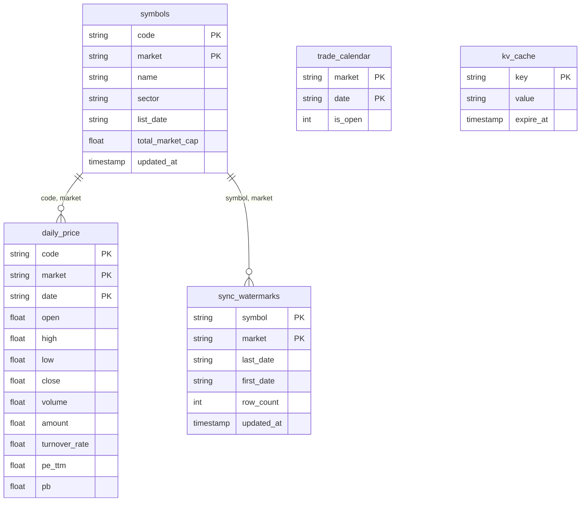

# DuckDB 本地优先与增量同步数据策略最佳实践

> **版本**: 2.1.0  
> **底层核心**: DuckDB (`quant_cache.duckdb`)  
> **归档支持**: SQLite (`quant_cache.db`, 只读冷归档)

---

## 1. 架构演进背景

在量化投资决策系统中，数据的存储引擎与读取策略直接决定了整个系统的响应上限与稳定性。

### 为什么从 SQLite 全面演进至 DuckDB？

早期架构采用 SQLite（`quant_cache.db`），但在数据量扩展至 **4,244 万行**（覆盖 A 股、港股、美股、ETF 26 年历史日线）时遇到了瓶颈：
- **行式存储扫描慢**：行式数据库在执行全市场横截面计算（如计算所有股票的 20 日/60 日动量、波动率分位数）时需要加载大量无关字段，I/O 开销巨大，耗时往往达数十秒。
- **并发分析能力受限**：SQLite 的文件锁机制限制了高并发只读分析与复杂 OLAP 窗口函数的执行效率。

**DuckDB 带来的飞跃**：
1. **纯列式存储（Columnar Storage）**：仅读取计算因子所需的 `close`, `date`, `code` 列，I/O 压缩比达 4~10 倍。
2. **向量化执行引擎（Vectorized Execution）**：利用现代 CPU SIMD 指令并行处理数据块，单核每秒处理数千万行，使 4,244 万行全量数据的多因子截面选股降至 **0.2 ~ 0.5 秒**。
3. **内置丰富窗口函数与统计聚合**：直接在 SQL 内完成复杂动量、移动平均、波动率分位数计算，无需将数据全量搬运到 Python 内存中用 Pandas 逐只循环。

> **当前双引擎策略**：
> - **`quant_cache.duckdb`**：唯一的活跃主存储引擎与分析引擎，承载所有读写操作。
> - **`quant_cache.db`**：保留作为离线冷归档文件，不再作为活动运行时读写依赖。

---

## 2. 数据库物理 Schema 设计

DuckDB 存储文件位于项目根目录：`quant_cache.duckdb`。



### 核心数据表结构

#### 1. 行情主表 (`daily_price`)
```sql
CREATE TABLE IF NOT EXISTS daily_price (
    code            VARCHAR NOT NULL,
    market          VARCHAR NOT NULL,
    date            VARCHAR NOT NULL,
    open            DOUBLE,
    high            DOUBLE,
    low             DOUBLE,
    close           DOUBLE,
    volume          DOUBLE,
    amount          DOUBLE,
    turnover_rate   DOUBLE,
    pe_ttm          DOUBLE,
    pb              DOUBLE,
    PRIMARY KEY (code, market, date)
);
```

#### 2. 标的元数据表 (`symbols` & `stock_pool`)
```sql
CREATE TABLE IF NOT EXISTS symbols (
    code             VARCHAR NOT NULL,
    market           VARCHAR NOT NULL,
    name             VARCHAR,
    sector           VARCHAR,
    industry         VARCHAR,
    list_date        VARCHAR,
    total_market_cap DOUBLE,
    is_active        BOOLEAN DEFAULT true,
    updated_at       TIMESTAMP DEFAULT CURRENT_TIMESTAMP,
    PRIMARY KEY (code, market)
);
```

#### 3. 增量同步水位线表 (`sync_watermarks`)
用于记录每个标的在本地缓存的最早/最新日期，实现精确到日期的增量断点续传。
```sql
CREATE TABLE IF NOT EXISTS sync_watermarks (
    symbol      VARCHAR NOT NULL,
    market      VARCHAR NOT NULL,
    last_date   VARCHAR NOT NULL,
    first_date  VARCHAR,
    row_count   BIGINT DEFAULT 0,
    updated_at  TIMESTAMP DEFAULT CURRENT_TIMESTAMP,
    PRIMARY KEY (symbol, market)
);
```

#### 4. 交易日历表 (`trade_calendar`) 与自愈机制
记录交易日开放状态，并内置自愈机制（Auto-Healing Calendar Tail）：若因节假日调休或网络原因缺失最新日历，系统会自动根据周一至周五工作日原则与实际收盘数据向前安全补齐。

#### 5. 键值缓存表 (`kv_cache`)
存储时效性短的非结构化快照（如个股研报、股吧情绪指标、实时市场宽度等），支持 TTL 自动失效。

---

## 3. 本地优先核心设计原则

```
      +-----------------------------------------+
      |            业务调用 / 选股 / 组合分析      |
      +--------------------+--------------------+
                           | 查询请求 (code, date_range)
                           v
      +--------------------+--------------------+
      |            DataEngine 调度器            |
      |                                         |
      |  1. 读取本地 DuckDB (quant_cache.duckdb) |
      |  2. 命中 -> 毫秒级直接返回 (0 网络时延)   |
      |  3. 未命中/数据过期 -> 计算缺失日期区间  |
      +--------------------+--------------------+
                           | 仅拉取缺失 Gap (last_date - 3)
                           v
      +--------------------+--------------------+
      |            多源容灾通道与校验层         |
      |  Baostock -> AKShare -> efinance/yfinance|
      |  入库前刚性校验 (负价格/高低倒挂拦截)   |
      +--------------------+--------------------+
                           | UPSERT (ON CONFLICT DO UPDATE)
                           v
      +--------------------+--------------------+
      |           写入 DuckDB 增量保鲜          |
      +-----------------------------------------+
```

### 原则 1：Cache 是唯一的分析源（Local-First）
远程 API 仅作为**数据保鲜与同步管道**，绝不作为直接查询计算层。所有量化策略、回测、因子打分必须且只能基于本地 DuckDB 缓存执行。

### 原则 2：默认增量保鲜，严禁全量重拉
- **冷启动（Cold Start）**：当本地库中某标的完全无数据时，以市场基线安全初始化（A 股: 2000-01-01，港股: 1995-01-01，美股: 1990-01-01）。
- **增量回填（Incremental Sync）**：读取 `sync_watermarks`，仅计算 `[last_cached_date, today]` 的缺失范围。使用支持日期区间传参的底层 API（如 `ak.stock_zh_a_hist(symbol, start_date, end_date)`），严禁使用全量下载接口。

### 原则 3：动态重叠 3 个交易日（Overlap Policy）
增量拉取时，起始日期设为 `last_cached_date - 3 交易日`。原因在于：
- 覆盖周末、节假日调休导致的日期对齐误差；
- 吸收交易所盘后数据补正与拆股/除权数据回溯修正。
写入时采用 `UPSERT`（`ON CONFLICT (code, market, date) DO UPDATE`）语义，最新数据始终覆盖。

### 原则 4：入库前刚性校验（Validate Before Cache）
任何远程拉取的数据在落库前必须通过质量守门员校验，直接丢弃畸变数据：
- 拒绝负数或零的开高低收价格；
- 拒绝最高价低于最低价（`high < low`）的非法 K 线；
- 拒绝成交量小于零的数据；
- 拒绝超出当前系统日期的未来日期数据。

---

## 4. 多源故障容灾与熔断保护

公共金融接口极易出现网络抖动、IP 限频（HTTP 429 / RemoteDisconnected）。系统实现 source-chain 多源熔断与降级策略：

| 市场/维度 | 主力数据通道 | 备用通道 1 | 备用通道 2 | 降级策略 |
|:---|:---|:---|:---|:---|
| **A 股日线行情** | **Baostock**（稳定长连接、不限频） | AKShare (EastMoney) | efinance | 优雅降级，使用本地已缓存历史继续计算 |
| **A 股基本面/财务** | 同花顺 (THS) 财务指标 | 新浪财经 | 东方财富网页截面 | 缺失时基于历史分位回退 |
| **港股/美股行情** | AKShare 境外接口 | yfinance (Yahoo Finance) | — | 保证核心龙头覆盖 |
| **ETF 基金行情** | AKShare 基金实时与历史 | 东方财富 ETF 专用接口 | — | ETF-first 语义，优先宽基与流动性龙头 |

### 熔断器机制（Circuit Breaker）
- 当某个数据源连续失败超过 3 次，熔断器打开，冷却 300 秒，在此期间直接跳过该源切换至备用源。
- 单次命令行执行中，若遇到全网 API 限频，记录警告日志并降级返回本地部分有效结果，保证 CLI 与 Agent 工具调用绝不发生未捕获崩溃。
