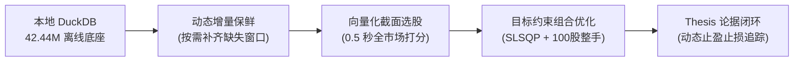

# stockaskill 从入门到实战：全流程量化决策与分析教程

> **适用对象**：量化研究员、个人投资者、AI 智能体（Agent）开发者  
> **核心引擎**：DuckDB 列式 OLAP 引擎（4,244 万行全市场行情与财务数据）  
> **运行环境**：Python >= 3.10 | 支持 Windows / macOS / Linux  
> **配套文档**：[功能全景手册](README.md) | [CLI 命令参考](cli-reference.md) | [数据策略规范](data-strategy.md)

---

## 目录

1. [项目概览与设计理念](#1-项目概览与设计理念)
2. [环境准备与极速安装](#2-环境准备与极速安装)
3. [本地数据保鲜与运维实战](#3-本地数据保鲜与运维实战)
4. [单标的多维度深度诊断](#4-单标的多维度深度诊断)
5. [亚秒级向量化多因子截面选股](#5-亚秒级向量化多因子截面选股)
6. [目标约束组合优化与整手下单](#6-目标约束组合优化与整手下单)
7. [一键全闭环量化决策流水线](#7-一键全闭环量化决策流水线)
8. [投资论据追踪与动态风控巡检](#8-投资论据追踪与动态风控巡检)
9. [智能体（AI Agent）集成与自动化](#9-智能体ai-agent集成与自动化)
10. [生产实战最佳实践与疑难排查](#10-生产实战最佳实践与疑难排查)

---

## 1. 项目概览与设计理念

在传统量化研究中，投资者和智能体往往面临以下三大痛点：
1. **接口限频与断连**：反复全量拉取历史 K 线导致 API 被封（如 `RemoteDisconnected` 或触发限流）。
2. **计算性能低下**：基于多线程或单股循环处理 5,000+ 只股票，选股一次动辄耗时数分钟。
3. **决策与执行割裂**：算出了优质股票与理论权重，却未考虑 A 股“100 股整手”买卖限制、宏观风险预算与持仓止盈止损。

**stockaskill** 针对上述问题构建了现代量化工程体系：



- **本地优先（Local-First）**：内置跨 26 年历史周期的 4,244 万行 DuckDB 列式底座，查询与因子计算 0 网络时延。
- **动态增量同步（Incremental Sync）**：从不盲目重拉历史，自动比对最新水位线并按需回填缺失区间。
- **严谨工程约束**：内置收益/最大回撤双重刚性约束优化求解，输出可直接下单的整手（Board Lot）交易单。

---

## 2. 环境准备与极速安装

### 2.1 基础环境

本项目要求 **Python >= 3.10**。推荐使用现代包管理工具 `uv` 或原生 `venv`。

```bash
# 1. 克隆代码仓库
git clone https://github.com/axjing/stockaskill.git
cd stockaskill

# 2. 创建并激活虚拟环境 (推荐 uv)
uv venv --python 3.10
# Windows PowerShell
.venv\Scripts\activate
# Linux / macOS
source .venv/bin/activate

# 3. 安装依赖
uv pip install -e .
```

### 2.2 验证引擎与缓存状态

安装完成后，首先检查底层 DuckDB 引擎健康度与历史数据覆盖：

```bash
# 检查当前存储引擎 (确认使用 DuckDB)
uv run python skills/stockaskill/scripts/run.py cache engine

# 查看本地数据总量与分布
uv run python skills/stockaskill/scripts/run.py cache stats
```

预期输出示例：
```text
Storage Engine: DuckDB
Database Path: D:\CODE\stockaskill\skills\stockaskill\scripts\quant_cache.duckdb
Status: Healthy

Cache Statistics:
  daily_price: 42,442,180 rows
  financial_indicator: 186,432 rows
  stock_pool: 5,421 rows
  trade_calendar: 8,920 rows
```

---

## 3. 本地数据保鲜与运维实战

在进行任何选股与组合构建前，必须保证目标股票的数据时效性。

### 3.1 检查数据状态 (`status data`)

使用 `status data` 可以极速检查指定股票或自选股的保鲜状态，绝不产生外部网络请求：

```bash
# 检查单只股票数据时效
uv run python skills/stockaskill/scripts/run.py status data symbol 600519 --market A

# 检查默认自选股池时效
uv run python skills/stockaskill/scripts/run.py status data watchlist --market A
```

终端将清晰展示数据行数、覆盖截止日期以及新鲜度（`fresh` / `stale`）。

### 3.2 动态增量保鲜 (`sync update`)

当发现某标的数据落后时，使用 `sync update` 进行增量回填。该指令会自动探测本地最新日期并仅向远端拉取缺失日期间隔（含 3 天安全重叠区）：

```bash
# 增量更新单个标的
uv run python skills/stockaskill/scripts/run.py sync update 600519 --market A

# 增量更新整个自选股监控池
uv run python skills/stockaskill/scripts/run.py sync update --scope watchlist --market A
```

> [!TIP]
> `sync update` 写入行情后会自动同步更新诊断状态表 `sync_state` 并增量刷新该标的的因子快照，确保诊断与选股直接命中本地最新计算。

### 3.3 数据质量巡检与分层修复 (`sync check` & `sync repair`)

```bash
# 对自选股进行数据完整性与异常值巡检
uv run python skills/stockaskill/scripts/run.py sync check --market A --codes 600519,000858

# 若发现存在 K 线空洞或财务缺失，执行带熔断的分层修复
uv run python skills/stockaskill/scripts/run.py sync repair --market A --codes 600519 --data-kinds history,fundamentals
```

---

## 4. 单标的多维度深度诊断

对目标标的进行基本面、估值、技术动量与财务健康度的综合扫描。

### 4.1 统一诊断门面 (`diagnose`)

系统提供分层诊断门面，支持 `--level quick|full|deep`：

```bash
# 1. 快速诊断 (quick: 核心因子 + 简要打分，耗时约 0.1s)
uv run python skills/stockaskill/scripts/run.py diagnose 600519 --market A --level quick

# 2. 完整诊断 (full: 默认级别，包含7大因子雷达、历史走势与财务健康度)
uv run python skills/stockaskill/scripts/run.py diagnose 600519 --market A --level full

# 3. 深度长报告诊断 (deep: 包含估值分位数、同业对比、风险警示与综合综述)
uv run python skills/stockaskill/scripts/run.py diagnose 600519 --market A --level deep
```

### 4.2 诊断评分卡 (`scorecard`)

通过可解释的启发式规则评估标的质地：

```bash
uv run python skills/stockaskill/scripts/run.py scorecard diagnose 600519 --market A
```

---

## 5. 亚秒级向量化多因子截面选股

本项目的核心王牌能力之一是基于 DuckDB OLAP 引擎的 **亚秒级全市场截面选股 (`screen`)**。

### 5.1 内置策略预设选股

系统预置了经过 A 股市场长期验证的成熟因子策略：

| 预设名称 (`--preset`) | 核心逻辑 | 适用市场阶段 |
|---------------------|---------|-------------|
| `momentum_enhanced` | 动量领涨 + 均线多头排列 + 质地过滤 | 趋势牛市、主升浪行情 |
| `low_vol` | 低波动异象 + 高分红/稳健盈利 + 避险防御 | 震荡市、防守防御期 |
| `deep_value` | 低估值 (PE/PB) + 高 F-Score 财务质量 | 市场底部反转期 |
| `quality_growth` | 高 ROE/ROIC + 持续营收与利润增长 | 核心资产成长行情 |

运行命令示例：

```bash
# 使用“低波动稳健”预设，在 A 股全市场中筛选前 10 只标的
uv run python skills/stockaskill/scripts/run.py screen --market A --preset low_vol --top 10

# 使用“动量增强”预设筛选前 5 只主升浪龙头
uv run python skills/stockaskill/scripts/run.py screen --market A --preset momentum_enhanced --top 5
```

整个筛选过程在 0.2 ~ 0.5 秒内即可完成 5,400+ 只股票的截面打分与排序，终端将以 ASCII 彩色表格呈现因子评分明细。

### 5.2 自定义多因子权重选股

如果需要构建专属的多因子组合，可以通过命令行直接注入权重参数：

```bash
uv run python skills/stockaskill/scripts/run.py screen --market A \
  --value-weight 0.2 \
  --quality-weight 0.3 \
  --momentum-weight 0.3 \
  --growth-weight 0.2 \
  --top 8
```

---

## 6. 目标约束组合优化与整手下单

选出股票后，如何科学配置权重？传统的等权重或市值加权无法满足投资者的风险收益目标。

`portfolio --optimize` 采用 **SLSQP 凸优化算法**，在硬性约束下求解最佳夏普比率配置，并自动转换为真实的整手（Board Lot）交易单。

### 6.1 组合优化求解实战

```bash
# 设定目标年化 12%，最大可承受回撤 6%，可用资金 50 万元，对 5 只标的进行求解
uv run python skills/stockaskill/scripts/run.py portfolio \
  --codes 600519,000858,601318,600036,002475 \
  --market A \
  --optimize \
  --target-cagr 0.12 \
  --max-drawdown 0.06 \
  --capital 500000
```

### 6.2 输出结果解析

优化器将输出高度详尽的配置单：
1. **风险预算与仓位上限**：根据当前宏观市场姿态（牛市/中性/防御）自动限定总权益仓位（如防守期限制最高 60% 仓位）。
2. **理论最优权重**：满足 CAGR >= 12% 且 MaxDD <= 6% 条件下的数学最优权重。
3. **一手整股票据（Board Lot Execution Tickets）**：
   - 自动向上取整为 100 股整倍数（如 600519 买入 200 股、000858 买入 800 股）。
   - 计算各标的预计占用资金与剩余闲置现金（Cash buffer）。
   - 保障在实际交易软件中一键填单，避免零股碎单无法买入的尴尬。

---

## 7. 一键全闭环量化决策流水线

为了最大化操作便利与智能体调用效率，stockaskill 支持将**选股、优化求解与票据生成**串联为一键闭环：

```mermaid
sequenceDiagram
    autonumber
    actor User as 用户 / Agent
    participant Screen as screen 选股器
    participant Opt as portfolio 优化器
    participant Alloc as 整手分配器
    participant Thesis as thesis 论据库

    User->>Screen: 发起预设选股 (screen --preset low_vol --top 5)
    Screen-->>Opt: 输送 Top 5 标的代码池
    Opt->>Opt: SLSQP 求解 (Target CAGR & MaxDD)
    Opt->>Alloc: 传入最优化权重 + 资金规模
    Alloc-->>Thesis: 生成带止损价的真实买单并持久化记录
    Thesis-->>User: 返回完整执行单与风控阈值
```

实操步骤：
1. 先通过 `screen` 获取当前市场前 5 只标的：
   ```bash
   uv run python skills/stockaskill/scripts/run.py screen --market A --preset low_vol --top 5 --json
   ```
2. 提取代码列表后直接输送给组合优化器：
   ```bash
   uv run python skills/stockaskill/scripts/run.py portfolio \
     --codes 600036,601328,601988,601288,601398 \
     --market A \
     --optimize \
     --target-cagr 0.08 \
     --max-drawdown 0.04 \
     --capital 1000000
   ```

---

## 8. 投资论据追踪与动态风控巡检

交易完成后，严格的仓位跟踪与动态止盈止损是长期稳健盈利的核心保障。

### 8.1 建立入场论据 (`thesis capture`)

买入标的后，记录买入原因、入场价格与预期周期：

```bash
uv run python skills/stockaskill/scripts/run.py thesis capture 600519 \
  --market A \
  --notes "低波动蓝筹配置，股息率 > 3.5%，等待估值修复" \
  --catalyst "三季报业绩稳定增长"
```

### 8.2 仓位巡检与动态风控预警 (`risk-alert`)

系统支持每日收盘后对持仓进行自动化风控扫描：

```bash
# 扫描所有已记录持仓的异动与破位风险
uv run python skills/stockaskill/scripts/run.py risk-alert --market A
```

当个股跌破动态止损线（如 -5%）或触及盈利目标时，系统将发出清晰预警提示。

### 8.3 投资复盘与归因 (`thesis postmortem`)

平仓出场后，记录盈亏并进行归因分析，不断迭代量化体系：

```bash
uv run python skills/stockaskill/scripts/run.py thesis postmortem \
  --code 600519 \
  --market A \
  --outcome win \
  --return-pct 15.2 \
  --notes "达到目标盈利位止盈平仓"
```

---

## 9. 智能体（AI Agent）集成与自动化

stockaskill 原生遵循 [AgentSkills.io Specification](https://agentskills.io/home) 规范，专为作为大模型工具链（Tool Calling）设计。

### 9.1 原生 `--json` 零磁盘流式输出

任何 CLI 命令只要附加 `--json` 参数，将完全关闭人类可读的终端修饰，直接向标准输出（stdout）流式吐出强类型、Schema 严谨的 JSON 字符串：

```bash
uv run python skills/stockaskill/scripts/run.py screen --market A --preset low_vol --top 3 --json
```

输出示例：
```json
{
  "market": "A",
  "preset": "low_vol",
  "total_screened": 5421,
  "top_count": 3,
  "stocks": [
    {
      "code": "600036",
      "name": "招商银行",
      "composite_score": 0.884,
      "volatility_score": 0.92,
      "pe": 5.8,
      "pb": 0.72
    }
  ]
}
```

智能体可以直接通过管道解析 stdout，无需等待磁盘写入与二次文件读取。

### 9.2 智能体框架无缝接入

将 `stockaskill/` 放置于对应 Agent 框架技能目录，即可实现即插即用：

- **Claude Code**: 放置于 `~/.claude/skills/stockaskill/`
- **OpenCode**: 放置于 `~/.config/opencode/skills/stockaskill/`
- **Cursor / Windsurf**: 将规则配置引入 `.cursor/rules/`
- **Codex / OpenClaw**: 自动读取 `SKILL.md`

在与 Agent 对话时，只需自然语言指示：
> *“帮我用低波动策略在 A 股选 5 只股票，然后按年化 10%、回撤 5% 的约束，给我出一份 30 万元的整手买入单。”*

Agent 将自动串联：
1. `screen --market A --preset low_vol --top 5 --json`
2. `portfolio --optimize --target-cagr 0.10 --max-drawdown 0.05 --capital 300000 --json`
3. 整理出清晰的交易票据呈现给您。

---

## 10. 生产实战最佳实践与疑难排查

### 最佳实践 1：永远优先检查本地，禁止无界全市场重拉
不要在没有范围约束的情况下运行全市场拉取。如果需要获取最新交易日行情，请使用 `sync update` 而不是全量下载。

### 最佳实践 2：DuckDB 单进程锁处理
DuckDB 作为高性能嵌入式列式数据库，具有严格的写锁保护机制。如果终端提示：
`IOException: Cannot open file ... File is already open in PID xxxxx`
说明后台有正在运行的同步或检查任务。请等待后台任务完成，或终止对应 PID 进程后再开启新会话。

### 最佳实践 3：交易日历自愈
系统内置了交易日历自动对齐机制。当本地日历缺失或与最新日期脱节超过 7 天时，系统会在执行查询时自动从新浪财经同步交易日历，无需人工维护。

---

### 下一步与延伸阅读
- 深入阅读 [DuckDB 本地优先数据策略规范](data-strategy.md)，理解 4,244 万行数据底层表结构。
- 查阅完整参数与标志：[CLI 命令参考手册](cli-reference.md)。
